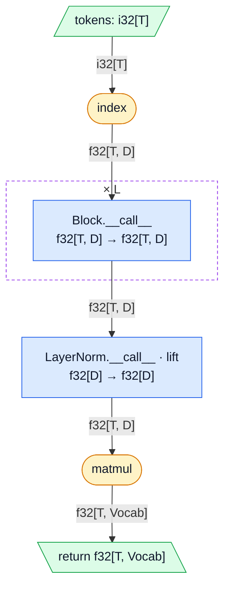

# expex

Shape-typed JAX in plain Python. The idea: be explicit about the shapes of
arrays, and of collections of arrays, and the library does the rest by reading
your annotations. Put the shapes in the signature:

```python
import jax
import jax.numpy as jnp
import jax.random as jr
import expex
from expex import fn, f32, i32

@fn
def attend[B, T, D](q: f32[B, T, D], k: f32[B, T, D]) -> f32[B, T, T]:
    return jnp.einsum("btd,bsd->bts", q, k)
```

and that signature is checked on every call, proved for all sizes without test
data, and used to vectorise the function. Inside `@fn`, plain `if` / `for` /
`while` work on traced values. It is ordinary JAX underneath: `jax.jit`,
`jax.grad`, `jax.vmap` and `jax.checkpoint` take an `@fn` like any function.

```
pip install -e .                               # Python 3.14+, JAX 0.12+
python examples/tour.py                        # see everything run
python -m expex examples/transformer.py        # prove a small transformer's shapes
```

| | |
|---|---|
| [Checked calls](#checked-calls) | errors that name the axis and where its size came from |
| [Sizes and axes by name](#sizes-and-axes-by-name) | `jnp.zeros((B, T))`, `x.reshape(T, H, K)`, `x.sum(T)`, `axis=T` |
| [Proofs](#proofs-without-data) | `expex.prove(f)`: the shapes hold for every size |
| [Plain Python control flow](#plain-python-on-traced-values) | `if` → `lax.cond`, `for` → `lax.scan` / `vmap`, `while` → `lax.while_loop` |
| [Vectorising](#vectorising) | `f.lift(...)` and `@expex.lift` map over extra leading axes |
| [Modules](#modules) | `@expex.struct`: typed, immutable classes that JAX can trace |
| [Random keys](#random-keys) | `@expex.random` and `expex.key()`, no key threading |
| [Compiling and gradients](#compiling-and-gradients) | `@expex.fn(jit=True, lift=True, random=True, remat=True)`, or JAX's own transformations |
| [Sharding](#sharding) | `expex.shard(f, mesh, B="data", D="model")`: shardings from axis names |
| [Diagrams](#diagrams) | `expex.diagram(f)`: an interactive architecture diagram, shapes on every edge, measured time per module, shape errors in place |
| [Cost estimates](#cost-estimates) | FLOPs and parameters as formulas in the sizes |
| [Precision constants](#precision-constants) | `expex.eps`, `expex.tiny`, `expex.huge` in the dtype they meet |
| [Debugging](#debugging) | where a NaN appeared, shapes line by line, memory, timing |

## Checked calls

```python
try:
    attend(jnp.ones((2, 3, 4)), jnp.ones((5, 3, 4)))
except expex.ShapeError as e:
    print(e)
```

```
attend(): argument `k` does not match its annotation.

    declared  k: f32[B, T, D]
    received     f32[5, 3, 4]

    B is 2 (from `q: f32[2, 3, 4]`), but axis 0 of `k` is 5.

    attend[B, T, D](q: f32[B, T, D], k: f32[B, T, D]) -> f32[B, T, T]
    defined at model.py:7
```

The result is checked too, and so are annotated local variables
(`h: f32[B, D] = ...`). Under `jax.jit` the checks run once, while tracing.

Sizes can be computed from other sizes and from int parameters, right in the
annotation, and constraints are `assert`s at the top of the body:

```python
@fn
def pad[B, T](x: f32[B, T]) -> f32[B, T + 1]:
    return jnp.pad(x, ((0, 0), (0, 1)))

@fn
def split_heads[T, D](x: f32[T, D], heads: int) -> f32[heads, T, D // heads]:
    assert D % heads == 0
    return x.reshape(T, heads, D // heads).transpose(1, 0, 2)

split_heads(jnp.ones((5, 8)), heads=2).shape     # (2, 5, 4)
```

```
>>> split_heads(jnp.ones((5, 8)), heads=3)
ShapeError: split_heads(): constraint `D % heads == 0` is violated (D=8, heads=3).
```

A leading `assert` on sizes is checked before the body runs, and the prover
assumes it. A leading assignment names a size for the signature and the body:

```python
@fn
def heads_first[T, D](x: f32[T, D], heads: int) -> f32[H, T, K]:
    H, K = heads, D // heads
    assert D % heads == 0
    h: f32[T, H, K] = x.reshape(T, H, K)
    return h.transpose(H, T, K)
```

Only names used in the signature are definitions; other assignments are
ordinary local variables. (Arithmetic in annotations works because Python 3.14
evaluates annotations lazily: expex reads them as written.)

## Sizes and axes by name

The sizes in the signature are names, and the body can use them. As a value,
a name is its size in this call; as an axis argument, it is that axis:

```python
@fn
def pool[B, T, D](x: f32[B, T, D]) -> f32[B, D]:
    return x.mean(T)                     # an axis

@fn
def swap[B, T, D](x: f32[B, T, D]) -> f32[T, B, D]:
    y = jnp.tanh(x).reshape(B, T, D)     # sizes
    return y.transpose(T, B, D)          # axes

@fn
def running_mean[N, D](xs: f32[N, D]) -> f32[N, D]:
    total = jnp.zeros(D)
    out = []
    for i in range(N):
        total = total + xs[i]
        out.append(total / (i + 1))
    return jnp.asarray(out)

pool(jnp.ones((2, 3, 4))).shape                  # (2, 4)
swap(jnp.ones((2, 3, 4))).shape                  # (3, 2, 4)
print(expex.prove(running_mean))                    # proved for all sizes
```

- **Axes**: positional arguments of array methods (`sum`, `mean`, `max`,
  `argmax`, `transpose`, `swapaxes`, ...) and `axis=` / `axes=` of any function
  (`jax.nn.softmax(x, axis=T)`). The position comes from the array's annotation
  (a parameter, or an annotated local `h: f32[B, T, D] = ...`), else from its sizes.
  When two axes have the same size and nothing says which is which, the call
  is an error asking for an annotation.
- **Sizes**: everywhere else: shapes, `range(N)`, arithmetic, slices. Under the
  prover the sizes are symbolic, so code built from them is proved for all sizes.
- `Dim` classes and variadics (`*B`, a tuple of sizes) work the same way.

Contractions and reshapes need only the names of the result:

```python
@fn
def attention[B, T, S, D](q: f32[B, T, D], k: f32[B, S, D]) -> f32[B, T, S]:
    return expex.einsum(q, k, to=(B, T, S))      # D is not in `to`: summed over

@fn
def heads[T, D](x: f32[T, D], n: int) -> f32[H, T, K]:
    H, K = n, D // n
    assert D % n == 0
    return expex.rearrange(x, to=(H, T, K))      # D split into H, K; T moved
```

Each operand's names come from its annotation, or from its sizes when they
are unambiguous; repeated names are matched, as in `jnp.einsum`. To give an
axis a second name (self-attention: keys along `S`), annotate a copy:
`keys: f32[B, S, D] = x`. `expex.rearrange` moves axes, splits one into several
new ones, or merges several into one new one.

## Proofs without data

`expex.prove` traces a function with symbolic sizes, so a passing proof holds for
every size:

```python
@fn
def diff[T, D](xs: f32[T, D]) -> f32[T, D]:
    return xs[1:] - xs[:-1]

print(expex.prove(diff))
```

```
diff: failed
    diff(): the return value does not match its annotation.

        declared  -> f32[T, D]
        returned     f32[T - 1, D]

        axis 0 of `return` should be T, but is T - 1.
    ...
```

`expex.prove(split_heads)` proves it for every `D` and `heads` with
`D % heads == 0`. Parameters such as `heads: int` are tried at a few values
(ints at 1 and 2, bools both ways, every `Literal` and enum value); others take
`@fn(examples={"name": [...]})`. Prove a whole package with `python -m expex pkg`
or `pytest --expex pkg`.

## Plain Python on traced values

```python
@fn
def collatz(n: i32) -> i32:
    steps = 0
    while n != 1:
        if n % 2 == 0:
            n = n // 2
        else:
            n = 3 * n + 1
        steps += 1
    return steps

print(jax.vmap(collatz)(jnp.array([6, 7, 27])))     # [  8  16 111]
```

```python
@fn
def rnn[T, D](xs: f32[T, D], w: f32[D, D]) -> f32[T, D]:
    h = jnp.zeros(xs.shape[1])
    hs = []
    for x in xs:
        h = jnp.tanh(w @ h + x)
        hs.append(h)
    return jnp.asarray(hs)

jax.jit(rnn)(jnp.ones((100, 3)), jnp.eye(3))
print(rnn.flow)        # {<line>: 'for -> lax.scan (carries h)'}
```

On Python values every statement runs exactly as written. On traced values:

- `if` becomes `lax.cond`, and `while` becomes `lax.while_loop`, with `break`,
  `continue` and `return` inside.
- A `for` over an array or a `range` becomes `vmap` when the iterations are
  independent, `lax.scan` otherwise. A 1000-step loop compiles in 0.06 s
  instead of 8 s unrolled.
- `x[i] = v` and `x[i] += v` become `x.at[i].set(v)` / `.add(v)`.
- `assert`, `raise` and `print` fire when the compiled code reaches them.
- Gradients through a traced `if` are NaN-free where a branch is not taken,
  so the `jnp.where`-with-sanitised-inputs trick becomes a plain `if`.

`f.flow` says how each statement ran; `@fn(convert=False)` opts out.

## Vectorising

A function's annotations say which axes are its own, so extra leading axes can
be mapped over without `in_axes`:

```python
@fn
def score[T, D](x: f32[T, D], w: f32[D]) -> f32[T]:
    return jnp.tanh(x @ w)

score.lift(jnp.ones((32, 5, 3)), jnp.ones(3)).shape                # (32, 5)
score.lift(jnp.ones((8, 1, 5, 3)), jnp.ones((7, 3))).shape         # (8, 7, 5)
```

Batch axes broadcast like NumPy. `@expex.lift` makes plain calls do the same, so
a function written for one element takes batches:

```python
@expex.lift
def safe_log(x: f32) -> f32:
    if x > 0:
        return jnp.log(x)
    return -jnp.inf

safe_log(jnp.array([[1.0, -1.0], [jnp.e, 0.0]]))     # [[0, -inf], [1, -inf]]
```

Compile time does not depend on the batch size: one example is traced.

## Modules

```python
from typing import Callable

@expex.struct
class Block[D]:
    w: f32[D, D] = jax.nn.initializers.normal(0.1)   # how to make it
    b: f32[D] = 0.0
    act: Callable = jax.nn.gelu          # plain Python types are static fields

    def __call__[B](self, x: f32[B, D]) -> f32[B, D]:
        return x + self.act(x @ self.w + self.b)

@expex.struct
class Stack[D]:
    blocks: list[Block[D]]

    def __call__[B](self, x: f32[B, D]) -> f32[B, D]:
        for block in self.blocks:      # identical blocks: one lax.scan, not 24 copies
            x = block(x)
        return x

model = Stack.init(jr.key(0), D=16, blocks=24)  # every array built from its annotation
y = jax.jit(lambda m, x: m(x))(model, jnp.ones((4, 16)))
grads = jax.grad(lambda m: m(jnp.ones((4, 16))).sum())(model)   # a Stack too
```

- A struct is a frozen dataclass and a pytree. Fields with array annotations
  are traced, fields with plain Python types are static.
- `Stack.init(key, <sizes>)` builds every array from its annotation. An array
  field's default says how: a JAX initializer (any function of `(key, shape,
  dtype)`) or a number to fill it with. Nested modules are built the same way;
  a list of them takes its length (`blocks=24`); other settings reach nested
  modules too (`heads=8`), and any field can be passed instead of built.
- The constructor takes the values themselves: `Block(w, b)`. A hand-written
  `__init__` also works: assign the fields as usual, and the result is checked
  against the annotations. JAX and `.replace(...)` rebuild objects without
  calling it.
- Every method is an `@fn` sharing the class's sizes, so
  `expex.prove(Block.__call__)` works without an instance.
- A loop over identical layers is one `lax.scan`, so a deep model compiles in
  the time one layer takes.
- `model.lift(x)` maps `__call__` over extra axes. Other decorators go on the
  methods themselves.

Annotations can use the struct's fields through `self`, and a method's
leading `assert` on the class's sizes and fields is an invariant of the class:
checked whenever an instance is passed in, and assumed by every function that
receives one, including the prover:

```python
@expex.struct
class Heads[D]:
    w: f32[D, D]
    heads: int = 4

    def split[T](self, x: f32[T, D]) -> f32[self.heads, T, D // self.heads]:
        assert D % self.heads == 0
        return (x @ self.w).reshape(T, self.heads, D // self.heads).transpose(1, 0, 2)

Heads(jnp.eye(8)).split(jnp.ones((5, 8))).shape      # (4, 5, 2)
print(expex.prove(Heads.split).ok)                      # True
```


### Model summary

```python
print(expex.summary(model, B=64))     # B: a size the call needs that the model does not have
```

```
Stack   (B=64, D=16, L=24)
module     class              params  formula       bytes   flops  flops formula
────────────────────────────────────────────────────────────────────────────────
blocks[*]  Block[D=16]  × 24     272  D² + D      1.09 kB    43 k  2·B·D² + 10·B·D
  w        f32[D, D]             256  D²          1.02 kB
  b        f32[D]                 16  D              64 B
────────────────────────────────────────────────────────────────────────────────
total      Stack               6,528  D²·L + D·L  26.1 kB  1.03 M  2·B·D²·L + 10·B·D·L
```

One row per module, a list of identical layers as one row; parameters and
FLOPs of a call, as formulas in the sizes and as numbers. `expex.summary(Stack,
D=16, blocks=24)` gives the same without building the model. In a notebook,
or with `.save("summary.html")`, it is a collapsible, sortable table.

### Saving and loading

```python
expex.save(model, "stack.npz")
model = expex.load(Stack, "stack.npz")            # no __init__ call, no key needed
model = expex.load(Stack, "stack.npz", D=16)      # and D must be 16
```

```
>>> expex.load(Mamba, "mamba.npz")
ShapeError: expex.load(Mamba, 'mamba.npz'):

    layers[2].mixer.x_proj: declared f32[R + 2 * N, E], file has f32[40, 128]

    axis 0 should be R + 2 * N = 36 (with N=16, R=4), but is 40.
```

- One `.npz` file, one array per field under a readable key
  (`layers[2].mixer.x_proj`), so other tools can read it with `np.load`.
- The structure comes from the class's annotations: nested structs, lists of
  structs, NamedTuples, `X | None`. Every array is checked against its
  annotation, with sizes shared across the whole model, as in a call.
- Static fields that are plain data (numbers, strings, `None`, tuples and
  lists of those) are saved too. Others, such as `act: Callable`, take the
  class default. Without one, load into an existing model, which supplies the
  structure and static fields: `expex.load(model, "stack.npz")`.
- Keys missing from the file are an error, and so are extra keys unless you
  pass `strict=False`.


### Comparing models and checkpoints

`expex.diff(a, b)` compares two models, or files written by `expex.save`, field by
field:

```python
small = Stack.init(jr.key(0), D=16, blocks=3)
expex.save(small, "base.npz")
grads = jax.grad(lambda m: (m(jnp.ones((4, 16))) ** 2).mean())(small)
tuned = jax.tree.map(lambda p, g: p - 0.1 * g, small, grads)   # one SGD step
print(expex.diff("base.npz", tuned))
```

```
6 changed, 0 unchanged

                                   max |a−b|  relative  changed
changed  blocks[1].b  f32[16]       2.50e-02  1.00e+00   100.0%
changed  blocks[2].b  f32[16]       2.10e-02  1.00e+00   100.0%
changed  blocks[0].b  f32[16]       1.89e-02  1.00e+00   100.0%
changed  blocks[1].w  f32[16, 16]   2.96e-02  1.15e-01   100.0%
changed  blocks[2].w  f32[16, 16]   3.45e-02  1.10e-01   100.0%
changed  blocks[0].w  f32[16, 16]   1.89e-02  1.04e-01   100.0%
```

(The biases started at zero, so their relative change is 1.)

Changes in structure come first (fields added or removed, such as a different
number of layers, changed shapes or dtypes, changed static fields), then
changed values, largest relative change ‖a−b‖ / max(‖a‖, ‖b‖) first, with the
fraction of elements beyond `atol` / `rtol`. In a notebook (or with
`.save("diff.html")`) it is a collapsible tree of the model, coloured by
change, with a filter for unchanged fields.

## Random keys

```python
@expex.random
@fn
def dropout[D](x: f32[D], rate: float = 0.5) -> f32[D]:
    keep = jr.bernoulli(expex.key(), 1 - rate, x.shape)
    return jnp.where(keep, x / (1 - rate), 0.0)

expex.seed(0)
dropout(jnp.ones(6))                        # different on every call
dropout(jnp.ones(6), key=jr.key(1))         # or choose the key
dropout.lift(jnp.ones((4, 6)))              # each row gets its own key
```

Every `expex.key()` is a new key. Nested calls, branches and loop iterations
derive their own, so eager, `jit`, `scan` and `vmap` runs draw the same
numbers. Under `jax.jit`, pass the key: the global key is Python state and
would be frozen into the compiled function.

## Compiling and gradients

The common transformations are options of `@expex.fn`, in any combination:

```python
@fn(jit=True, remat="dots")
def repeat[N](x: f32[N], n: int, scale: float) -> f32[N * n]:
    return jnp.tile(x, n) * scale

repeat(jnp.ones(3), 4, 0.5).shape                       # (12,)
```

| Option | |
|---|---|
| `jit=True` | compile; static arguments are read from the signature |
| `lift=True` | plain calls take extra leading batch axes |
| `random=True` | `expex.key()` inside gives a fresh key on every call |
| `remat=True` | recompute in the backward pass (`jax.checkpoint`); or a policy: `"dots"`, `"dots_no_batch"`, `"everything"` |
| `donate=("state",)` | with `jit`: reuse these arguments' buffers |

Each is also a decorator of its own (`@expex.jit`, `@expex.lift`, `@expex.random`,
`@expex.remat`). Static arguments are the ones with plain Python types (`int`,
`str`, tuples, callables, enums) and `Static[...]`; arrays and `float`
numbers are traced, so a new learning rate does not recompile. A compiled
random function draws a fresh key on every call, or takes `key=`.

JAX's own transformations work on any `@fn` too: `jax.jit(f,
static_argnames=...)`, `jax.grad`, `jax.vmap`, `jax.checkpoint`.

`expex.compile_cache(path)` keeps compiled programs on disk across runs.

## Sharding

Every array's axes are named in its annotation, so say once which sizes are
split over which mesh axes, and every array gets its sharding: no
`PartitionSpec`s by hand.

```python
from jax.sharding import AxisType

n = jax.device_count()                    # e.g. 8 devices: make_mesh((2, 4), ...)
mesh = jax.make_mesh((n, 1), ("data", "model"), axis_types=(AxisType.Auto,) * 2)
names = dict(B="data", D="model")

print(expex.shardings(model, mesh, **names).blocks[0].w.spec)   # P('model',): w is f32[D, D]

model = expex.device_put(model, mesh, **names)
forward = expex.shard(Stack.__call__, mesh, **names)
out = forward(model, jnp.ones((8 * n, 16))) # x: f32[B, D], and the result, split as B, D
```

- `expex.shardings(tree, mesh, **names)` gives the `NamedSharding`s of a model
  (or of `jax.eval_shape(...)` of one, before any memory is used), with lists
  of layers and nested modules; `expex.device_put` places a tree by them.
- `expex.shard(f, mesh, **names)` is `expex.jit(f)` with the arguments placed and
  the result constrained by their annotations. Intermediates need nothing:
  XLA propagates on `Auto` mesh axes. (`jax.make_mesh` makes `Explicit` ones
  by default, where JAX asks for an `out_sharding` at contractions over a
  split axis.)
- Sizes not named are replicated, and so is a repeated one after its first
  axis (`f32[D, D]` is `P("model", None)`). A mapping is a mesh axis, a tuple
  of them, or `None`.
- A size that its mesh axis cannot split evenly is an error naming the array:
  `Stack.blocks[0].w: f32[D, D] has D = 6 on axis 0, which mesh axis 'model'
  cannot split evenly (4 devices do not divide 6).`

## Cost estimates

`expex.cost` counts a function's FLOPs, and a module's parameters, as formulas in
its sizes. Like the prover, it needs no data:

```python
print(expex.cost(Stack.__call__))
print(expex.cost(Stack.__call__, B=64, D=1024, blocks=24))
```

```
Stack.__call__   (sizes: B, D, L)
  flops        2·B·D²·L + 10·B·D·L
  parameters   D²·L + D·L
  largest      f32[B,D] (B·D elements)
  note: L = len(self.blocks)
Stack.__call__   (sizes: B=64, D=1024, L=24)
  flops        3236954112   = 3.24 GFLOP
  parameters   25190400   = 25.2 M
```

Dominant terms come first. For the transformer in `examples/`, the four
`D × D` projections give `8·T·D²·L`, the MLP `4·T·D·F·L`, attention
`4·T²·D·L` and the unembedding `2·T·D·Vocab`. Matrix products and loops are
exact (a `for` over `T` multiplies its body by `T`); elementwise operations
count one flop per element, reshapes and gathers are free, and a `while`
loop counts one iteration and says so.

### Profiles, line by line

`expex.debug.profile` puts `expex.cost`'s numbers on the source. It traces the function with
symbolic sizes, so you don't need data. Each line, and each line of the functions it
calls, shows the shape it produces, its FLOPs as a formula and, once sizes are given,
as a number and a share of the total:

```python
report = expex.debug.profile(Stack.__call__, B=64, D=1024, blocks=24)
report.save("profile.html")           # the source as a heat map, FLOPs or bytes
```

For the transformer in `examples/` (`T=1024, D=512, F=2048, Vocab=32000, blocks=12`):

```
Transformer.__call__   (sizes: T=1024, D=512, F=2048, Vocab=32000, L=12)
  flops  8·T·D²·L + 4·T·D·F·L + 4·T²·D·L + 31·T²·L + 20·T·D·L + 8·T·F·L + 2·T·D·Vocab + 16·T·L + 9·T·D + 9·T + 5·L + 2  = 137 GFLOP
  bytes  136·T²·L + …  = 3.77 GB

── Transformer.__call__   transformer.py:86   self 24.4%
   86 | def __call__[T](self, tokens: Int[T]) -> f32[T, Vocab]:
   87 |     x = self.embed[tokens]                                f32[T,D]       3·T                           3.07 kFLOP   0.0%             2.11 MB
   88 |     for block in self.blocks:  # identical blocks: one …
   89 |         x = block(x)                                      f32[T,D]       ×L -                                       0.0%             calls 75.6%  277 MB
   90 |     return self.norm.lift(x) @ self.unembed               f32[T,Vocab]   2·T·D·Vocab                   33.6 GFLOP  24.4% ██          131 MB

── MLP.__call__   transformer.py:63   self 37.7%
   64 |     return jax.nn.gelu(x @ self.w1) @ self.w2             f32[T,D]       ×L 4·T·D·F·L + 8·T·F·L        51.7 GFLOP  37.7% ████        931 MB

── Attention.causal   transformer.py:44   self 19.0%
   47 |     scores = q @ k.T / jnp.sqrt(q.shape[-1])              f32[4,T,T]     ×L 2·T²·D·L + 4·T²·L + L      12.9 GFLOP   9.4% █           428 MB
   49 |     weights = jax.nn.softmax(jnp.where(mask, scores, -j…  f32[4,T,T]     ×L 24·T²·L + 4·T·L             302 MFLOP   0.2%             1.11 GB
   50 |     return weights @ v                                    f32[4,T,D//4]  ×L 2·T²·D·L                   12.9 GFLOP   9.4% █           25.2 MB
...
```

- Each operation is counted once, on the innermost line that created it. A line that
  calls into other functions shows their share as `calls`. The per-line counts add up
  to `expex.cost(f).flops`.
- Lines inside a staged loop are multiplied by the loop's trip count and marked: `×L`
  for a loop over a list of modules, `×T` for `range(T)`.
- The last column is the bytes the line's operations produce (data written, not peak
  memory; for peak memory, use `expex.debug.memory`).
- `profile.save("profile.html")`, or a notebook's rich display, gives a self-contained
  page. Each line has a heat map you can switch between FLOPs and bytes, and hovering
  over a line shows its formula. Each function is a collapsible section.

## Diagrams

`expex.diagram` draws a function or a module from a trace with symbolic sizes,
so like `expex.cost` and `expex.prove` it needs no data:

```python
d = expex.diagram(Stack.__call__)                  # depth=1: the calls it makes
print(d)                                        # Mermaid text, for Markdown
d.save("stack.html")                            # an interactive page
expex.diagram(Stack.__call__, depth=2)             # every call opened one level
expex.diagram(Stack.__call__, B=64, blocks=24)     # sizes and list lengths, as for expex.cost
```

For the transformer in `examples/`, `print(expex.diagram(Transformer.__call__))`
gives this, which GitHub draws in a `mermaid` block:



- Each call to an `@fn` is a node showing its input and output types (per
  element for `.lift`). `depth=2`, or a click on the page, opens it to show
  the calls inside. A loop over identical layers is one box, `× L`; the
  selective scan in `examples/mamba/` is a box `× T`. A traced `if` or
  `while` is a box too.
- Between calls, only operations that say what the model does are drawn
  (`matmul`, `index`, `sum`, `conv`, ...). Reshapes and elementwise
  arithmetic are skipped, with edges drawn straight across them. Each edge
  follows the data and shows its type.
- The page pans and zooms, opens and folds calls, and shows each call's
  signature, file and line, and source. It loads Mermaid from a CDN.


<!-- To insert at the end of README's "## Diagrams" section, after its bullet list. -->

### Where the time goes, and where shapes fail

`expex.diagram.timed` draws the same diagram from a run on real arguments. It
compiles the function with `jax.jit`, runs it under `jax.profiler`, and colours
each call and loop by its share of the measured time. Shape errors get a
diagram too. A `ShapeError` raised inside a typed call carries `e.diagram`,
which is the trace up to the call that failed:

```python
d = expex.diagram.timed(model.__call__, jnp.ones((256, 16)))  # runs it, under jax.jit and jax.profiler
print(d.text)
d.save("stack_timed.html")                       # each box coloured by its share of the time

@expex.struct
class Probe[D]:
    stack: Stack[D]
    w: f32[D] = 1.0

    def __call__[B](self, x: f32[B, D]) -> f32[B]:
        return self.stack(x[:, 1:]) @ self.w     # a bug: x loses a feature

probe = Probe.init(jr.key(1), D=16, blocks=2)
try:
    probe(jnp.ones((4, 16)))
except expex.ShapeError as e:
    print(e.diagram.text)                        # the trace up to the call that failed
    e.diagram.save("error.html")                 # that call in red, the path into it in red
```

```
Stack.__call__   measured with jax.profiler (CPU): 285 µs of XLA op time per call (summed over threads), 320 µs wall, median of 5 runs
  × 24                  273 µs   95.8%  ███████████████████
    Block.__call__      250 µs   87.8%  ██████████████████
  (outside the calls)   11.9 µs    4.2%
Probe.__call__   ShapeError: traced up to the failing call
  Stack.__call__  ✗ received f32[4, 15], declared x: f32[B, D]

  path:  x: f32[4, 16] → ✗ Stack.__call__

  Stack.__call__(): argument `x` does not match its annotation.
  ...
```

- The profiler names XLA instructions, not Python calls. expex looks each one
  up in the compiled program, where it carries the scopes of the calls it came
  from. A fused instruction that spans calls is split between them. A loop's
  body runs once per iteration, so `× 24` adds up all 24. Each call's time
  includes the calls inside it. Shares are of XLA op time summed over threads,
  so on CPU they can add up to more than the wall time.
- When the profiler can't run, the shares are estimated from FLOPs per box
  (counted as `expex.cost` counts them). The diagram is then labelled `ESTIMATED`.
- `d.timings` maps boxes to (seconds per call, share), and `d.at(2)` opens the
  diagram one level further.
- `e.diagram` is built only when you use it, so calls that succeed cost
  nothing extra. It traces the function again on the arguments' shapes, with
  loops unrolled, up to the call that fails. That call is drawn in red, with
  the type it received and the one it declared, and the edges from the inputs
  to it are red too. The calls around it are open. The error's message is
  unchanged. A note under it says `(see e.diagram.save("error.html"))`.
  `expex.diagram.explain(f, *args)` draws the same thing without running `f`.

## Precision constants

`expex.eps`, `expex.tiny` and `expex.huge` are the limits of whatever floating dtype
they meet, so the same code is right in bfloat16, float32 and float64:

```python
@fn
def entropy_safe[N](p: f32[N]) -> f32:
    return -(p * jnp.log(p + expex.tiny)).sum()       # tiny of p's dtype

x = jnp.ones(3, jnp.bfloat16)
x + expex.eps                                         # bfloat16's epsilon: 0.0078125
x / (x.sum() + 1e3 * expex.eps)                       # scaled, still in x's dtype
jnp.maximum(x, expex.tiny(x))                         # as an argument: give it the array
```

## Debugging

```python
@fn
def entropy[N](logits: f32[N]) -> f32:
    p = jax.nn.softmax(logits)
    return -(p * jnp.log(p)).sum()

print(expex.debug.find_nan(entropy, jnp.array([0.0, 200.0, -200.0])))
```

```
NaN first appears at model.py:4 (entropy)
    > return -(p * jnp.log(p)).sum()
  operation: mul
  inputs:
    #0: f32[3]  min=0  max=1  (2 zero, of 3)
    #1: f32[3]  min=0  max=0  (2 -inf, 1 zero, of 3)
```

`find_nan` replays the program one operation at a time, including inside loops
and branches. `expex.debug.shapes` annotates every line with its shapes, here for
all sizes at once:

```python
@fn
def attention[B, T, D](q: f32[B, T, D], k: f32[B, T, D]) -> f32[B, T, T]:
    scores = q @ k.swapaxes(-1, -2)
    return jax.nn.softmax(scores, axis=-1)

print(expex.debug.shapes(attention))
```

```
attention[B, T, D](q: f32[B, T, D], k: f32[B, T, D]) -> f32[B, T, T]   [symbolic B, D, T]
   ... | def attention[B, T, D](q: f32[B, T, D], k: f32[B, T, D]) -> f32[B, T, T]:
   ... |     scores = q @ k.swapaxes(-1, -2)            # scores: f32[B, T, T]
   ... |     return jax.nn.softmax(scores, axis=-1)     # -> f32[B, T, T]
```

| Tool | |
|---|---|
| `expex.debug.find_nan(f, *args)` | the first operation that made a NaN or inf, with its inputs |
| `expex.debug.shapes(f[, *args])` | every line with its shapes, symbolic or concrete |
| `expex.debug.memory(f, *args)` | peak memory, and which values on which lines make it up |
| `expex.debug.timing(f, *args)` | trace, compile and run time |
| `expex.debug.ops(f, *args)` | operations by kind and line; flags unrolled loops and big constants |
| `f.info()` | everything expex knows about a function |
| `expex.show(tree)` | a pytree as shapes: `Params(w=f32[3, 3], b=f32[3])` |


### Activations and gradients, call by call

`expex.debug.watch` runs one forward and backward pass of a loss and reports
every typed call made on the way: statistics of its output, and of the
gradient of the loss with respect to that output.

```python
x = jr.normal(jr.key(1), (8, 16))
loss = lambda m: (m(x) ** 2).mean()
print(expex.debug.watch(loss, model))       # one row per call, each layer its own row

blocks = list(model.blocks)
blocks[5] = blocks[5].replace(w=blocks[5].w * 1e3)        # plant a problem
w = expex.debug.watch(loss, model.replace(blocks=blocks), growth=10.0)
for row in w.flagged:
    print(row.name, row.flags)
w.save("watch.html")                     # collapsible, sortable, RMS per layer as bars
```

```
watch <lambda>: loss 96.568, 25 calls, 0 flagged  (grad_ratio=100.0, growth=10.0)
                                         ──────────────output──────────────  ─────────d loss / d output─────────
  call                   shape       ×n    mean   std  |max|   rms  nan/inf   mean    std  |max|    rms  nan/inf  flags
  Stack.__call__         f32[8, 16]   1    7.05  6.85   30.3  9.83            0.11  0.107  0.473  0.154
    blocks[0].__call__   f32[8, 16]   1  0.0582  1.06   2.82  1.07            2.44   5.52   39.1   6.04
    blocks[1].__call__   f32[8, 16]   1    0.13  1.09    3.2   1.1            2.32   4.71   33.2   5.25
    ...
    blocks[23].__call__  f32[8, 16]   1    7.05  6.85   30.3  9.83            0.11  0.107  0.473  0.154
blocks[0].__call__ ["gradient exploding: RMS 1.8e+03× the layers' median"]
...
blocks[4].__call__ ["gradient exploding: RMS 1.3e+03× the layers' median"]
blocks[5].__call__ ['activations growing: RMS ×2.8e+02 from blocks[4].__call__']
```

- The loss function returns a scalar, or `(loss, aux)` (kept as `w.aux`).
  Its first argument is usually the model: methods of the modules in it are
  named by path (`blocks[3].attn.__call__`), other functions by name, with a
  call index when one is called more than once (`Attention.causal#3`).
- Each row has the output's shape, mean, std, largest magnitude, RMS and
  NaN / inf counts, and the same for `d loss / d output`. A lifted call is
  one row over the whole batch: `×n` counts the outputs it covers.
- A row is flagged (`!` in the text) when its output or gradient is not
  finite, when its gradient RMS is more than `grad_ratio` (100) times above
  or below the median of the same module over the layers, or when its output
  RMS grows by more than `growth` (10) from the previous layer.
- `w.rows` gives the numbers (`w.rows[1].grad["rms"]`). In a notebook, or
  with `w.save(...)`, it is a page with a bar per layer for repeated modules.
- Loops over layers run unrolled while watching, so each layer is traced on
  its own; `unroll=False` keeps them as one `lax.scan` and gives one row for
  all layers. JAX's caches are cleared before and after, so compiled
  functions are traced again: they compile again on their next call.

## Annotations

```python
from typing import Literal, NamedTuple
from expex import Dim, Int, Key

class RGB(Dim, size=3): ...          # a named fixed size

class Params[D](NamedTuple):         # dataclasses work too
    w: f32[D, D]
    b: f32[D]

@fn
def example[*Batch, H, W](
    img: f32[*Batch, H, W, RGB],     # *Batch: any number of axes
    idx: Int[*Batch],                # any integer dtype
    p: Params[W],                    # fields are checked, D is bound to W
    pair: f32[Literal[2], ...],      # a literal size, then any axes
    scale: f32,                      # a scalar array or a Python number
    steps: int = 1,                  # a plain Python value
    key: Key | None = None,
) -> f32[*Batch, H]:
    return img.mean((-1, -2)) * scale * steps
```

| Kind | Annotations |
|---|---|
| Arrays | `f16 f32 f64 i8 … i64 u8 … u64 c64 c128`, any of a kind: `Float Int UInt Bool Complex Num Arr` |
| Sizes | type parameters (`def f[B, T]`), `Literal[3]`, `class RGB(Dim, size=3)`, `*Rest` (any number of axes, the same everywhere), `...` (any number, unchecked), `Any` (one, unchecked) |
| Derived sizes | `f32[T + 1]`, `f32[heads, D // heads]`, `f32[self.heads]`; constraints: a leading `assert T >= 2` |
| Containers | `tuple[...]`, `list[X]`, `dict[str, X]`, `X \| None`, NamedTuples and dataclasses, generic ones too |
| Stacked | `Batch[Transition, T, N]`: a `Transition` whose arrays all have leading axes `T, N` |
| Plain values | `int`, `float`, `bool`, `str`, `Literal`, enums, callables, config classes |

## Ported projects

Existing codebases rewritten in this style and checked against the
originals:

- **[PureJaxRL](https://github.com/luchris429/purejaxrl) PPO** (`examples/ppo/`):
  plain loops instead of four nested `lax.scan`s, `if done:` for the
  auto-reset. Identical to the original for the first 21 of 976 updates, then
  drifting as float32 programs do; same speed; all shapes proved.
- **[mamba-jax](https://github.com/vvvm23/mamba-jax) Mamba** (`examples/mamba/`):
  the selective scan is a plain `for` loop over time, sizes are used by name
  (`xz[:, :E]`, `jnp.zeros((E, N))`), and generation is a loop carrying the
  layers' states. Logits match the original to 6e-7, gradients to 8e-7
  (relative) and sampled tokens exactly; all 11 functions are proved. On a
  2048-token sequence on CPU it runs 4.5x faster forward and 3x faster for
  gradients (the original materialises the full `T x E x N` decay before
  scanning, and recomputes it under `jax.checkpoint` to save memory).

## Limitations

- Conversion needs the function's source, so functions defined with `exec` or
  at a bare `python` prompt run unconverted (`f.info()` says why).
- Left as plain Python: code inside `try` / `with`, loops with an `else`,
  in-place updates of anything but a local variable, and variables shared with
  a nested function. A variable assigned on only one traced path reads as
  zeros on the other.
- `lift` needs batch axes in front, and not on arguments with a `*Rest` shape.
- `debug.find_nan` and parts of the prover read JAX internals; they are tested
  on JAX 0.12.
- A `spot-checked` proof verdict is evidence, not proof.
