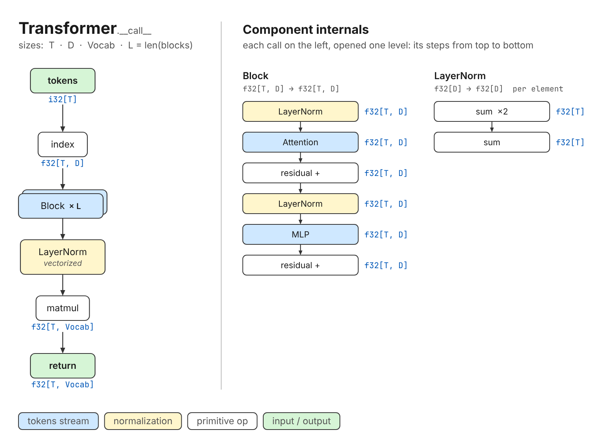
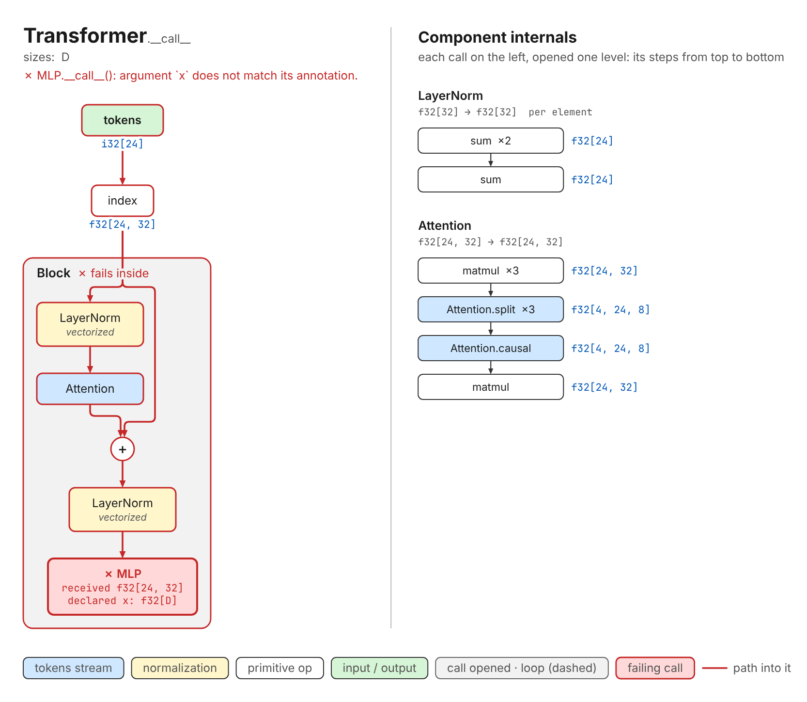

# expex

[](LICENSE)
[](https://www.python.org/downloads/)
· Docs: [docs/](docs/README.md) (site: https://davidesartor.github.io/expex/, pending its first deploy)
· [Changelog](CHANGELOG.md)

**Write the shapes in the signature; get checks, proofs, loops and model tools for free.**

expex is a thin layer over JAX. Annotate arrays with their sizes and the
library reads those annotations: it checks every call, proves the shapes for
every size, turns plain Python loops into `lax.scan`, and draws, costs and
debugs your model. It is still JAX underneath: `jax.jit` and `jax.grad` work as
usual, and a compiled call costs the same as plain `jax.jit`.

```
pip install expex          # Python 3.14+, JAX 0.12+
```

```python
import jax, jax.numpy as jnp, jax.random as jr
import expex
from expex import f32

key = jr.key(0)
```

## JAX vs expex

### Shapes are checked, not commented

```python
# JAX
def attend(q, k):
    # q: [B, T, D], k: [B, S, D] -> [B, T, S]
    assert q.shape[0] == k.shape[0]
    assert q.shape[2] == k.shape[2]
    return jnp.einsum("btd,bsd->bts", q, k)

# expex
@expex.fn
def attend[B, T, S, D](q: f32[B, T, D], k: f32[B, S, D]) -> f32[B, T, S]:
    return expex.einsum(q, k, to=(B, T, S))
```

### Loops are loops

```python
# JAX
def rnn(w, xs):  # w: [D, D], xs: [T, D]
    def step(h, x):
        h = jnp.tanh(w @ h + x)
        return h, h
    h0 = jnp.zeros(xs.shape[1])
    _, hs = jax.lax.scan(step, h0, xs)
    return hs

# expex
@expex.fn
def rnn[T, D](w: f32[D, D], xs: f32[T, D]) -> f32[T, D]:
    h, hs = jnp.zeros(D), []
    for t in range(T):  # a lax.scan carrying h
        h = jnp.tanh(w @ h + xs[t])
        hs.append(h)
    return jnp.asarray(hs)
```

### Branches are `if` / `else`

```python
# JAX
@jax.jit
def safe_log(x):
    ok = x > 0
    safe = jnp.where(ok, x, 1.0)
    return jnp.where(ok, jnp.log(safe), -jnp.inf)

# expex
@expex.fn(jit=True)
def safe_log(x: f32) -> f32:  # written for one number, called on arrays
    return jnp.log(x) if x > 0 else -jnp.inf  # a select per element
```

### Models are classes; identical layers scan themselves; batches map themselves

```python
# JAX
def init(key, D, L):
    # stacked by hand so lax.scan can loop
    w = jr.normal(key, (L, D, D)) * 0.1
    return {"w": w, "b": jnp.zeros((L, D))}

def stack(params, x):
    def layer(x, p):
        y = p["w"] @ x + p["b"]
        return x + jax.nn.gelu(y), None
    x, _ = jax.lax.scan(layer, x, params)
    return x

params = init(key, D=64, L=12)
ys = jax.vmap(stack, in_axes=(None, 0))(params, jnp.ones((8, 64)))

# expex
@expex.struct
class Block[D]:
    w: f32[D, D] = jax.nn.initializers.normal(0.1)
    b: f32[D] = 0.0

    def __call__(self, x: f32[D]) -> f32[D]:
        y = self.w @ x + self.b
        return x + jax.nn.gelu(y)

@expex.struct
class Stack[D]:
    blocks: list[Block[D]]

    def __call__(self, x: f32[D]) -> f32[D]:
        for block in self.blocks:  # identical layers: one lax.scan
            x = block(x)
        return x

model = Stack(key, D=64, blocks=12)  # a key first: built from the annotations
ys = model(jnp.ones((8, 64)))  # extra leading axes are mapped over
```

Any typed call given extra leading axes maps over them, so a layer written for
one token takes a sequence (`self.norm(h)`), and a model written for one
example takes a batch. `@expex.fn(vectorize=False)` opts out. Sizes can also
come from a config (`Stack(key, cfg)`, a dict or dataclass with `D` and
`blocks`), and `model.sizes` reads them back.

A wrong call says which axis is wrong and where its size came from:

```python
try:
    attend(jnp.ones((2, 3, 4)), jnp.ones((5, 3, 4)))
except expex.ShapeError as e:
    print(e)
```

```
attend(): argument `k` does not match its annotation.

    declared  k: f32[B, S, D]
    received     f32[5, 3, 4]

    B is 2 (from `q: f32[2, 3, 4]`), but axis 0 of `k` is 5.

    attend[B, T, S, D](q: f32[B, T, D], k: f32[B, S, D]) -> f32[B, T, S]
    defined at example.py:2
  see https://github.com/davidesartor/expex/blob/main/docs/errors.md#ex101
```

Every error has a code (here `e.code == "EX101"`), and its message ends with a
link to its explanation in [docs/errors.md](docs/errors.md).

Sizes can be computed (`f32[T + 1]`, `f32[heads, D // heads]`) or fixed with
the others (`def drop[B, Rows = 6, Cols = 7]`), and helpers and lambdas defined
inside a call see its sizes.

## What else the annotations give you

None of this needs example data, unless it measures something.

**Proofs for every size**, also from the command line (`python -m expex pkg/`) and
in pytest (`pytest --expex pkg`):

```python
print(expex.prove(Stack.__call__))
```

```
__main__.Stack.__call__: proved for all sizes
```

**Cost as formulas in the sizes**, or as numbers for given sizes:

```python
print(expex.cost(Stack.__call__))
```

```
Stack.__call__   (sizes: D, L)
  flops        2·D²·L + 10·D·L
  parameters   D²·L + D·L
  largest      f32[D] (D elements)
  note: L = len(self.blocks)
```

**Changing part of a model**, checked against its annotation:

```python
edited = model.at.blocks[5].w.multiply(0.5)   # a copy with one block's weights scaled
edited = edited.at.blocks[0].b.set(jnp.ones(64))  # also .add, .apply(f), .get()
```

**Model summaries:**

```python
print(expex.summary(model))
```

```
Stack   (D=64, L=12)
module     class              params  formula       bytes   flops  flops formula
────────────────────────────────────────────────────────────────────────────────
blocks[*]  Block[D=64]  × 12   4,160  D² + D      16.6 kB  8.83 k  2·D² + 10·D
  w        f32[D, D]           4,096  D²          16.4 kB
  b        f32[D]                 64  D             256 B
────────────────────────────────────────────────────────────────────────────────
total      Stack              49,920  D²·L + D·L   200 kB   106 k  2·D²·L + 10·D·L
```

**Architecture diagrams**, drawn from the code. `expex.diagram(Transformer.__call__)`
for the transformer in [`examples/`](examples/transformer.py); save it as `.svg`,
`.png`, or an interactive `.html` page where you click a call to open it:

<picture>
  <source media="(prefers-color-scheme: dark)" srcset="docs/images/transformer_dark.png">
  
</picture>

The same diagram timed on real inputs (`expex.diagram.timed(model, tokens)`), and
the one a `ShapeError` carries (`e.diagram`), here for an attention layer that
forgot to split the keys into heads (`k = x @ self.wk`): the failing call and
the path into it are in red. All of them follow your light or dark theme:

<picture>
  <source media="(prefers-color-scheme: dark)" srcset="docs/images/transformer_timed_dark.png">
  
</picture>

<picture>
  <source media="(prefers-color-scheme: dark)" srcset="docs/images/transformer_error_dark.png">
  
</picture>

`expex.inspect(model, x)` puts the summary, the diagram, the cost, the
activations and the line profile on one page, with a tab each.

**Debugging:** shapes line by line, and where a NaN first appeared:

```python
print(expex.debug.shapes(Block.__call__))
```

```
__call__(self: Block, x: f32[D]) -> f32[D]   [symbolic D]
   75 |         y = self.w @ x + self.b     # y: f32[D]
   76 |         return x + jax.nn.gelu(y)   # -> f32[D]
```

```python
@expex.fn
def entropy[N](logits: f32[N]) -> f32:
    p = jax.nn.softmax(logits)
    return -(p * jnp.log(p)).sum()

print(expex.debug.find_nan(entropy, jnp.array([0.0, 200.0, -200.0])))
```

```
NaN first appears at example.py:4 (entropy)
    > return -(p * jnp.log(p)).sum()
  operation: mul
  inputs:
    #0: f32[3]  min=0  max=1  (2 zero, of 3)
    #1: f32[3]  min=0  max=0  (2 -inf, 1 zero, of 3)
  output:
    f32[3]  min=0  max=0  (2 nan, 1 zero, of 3)
  infinities appeared earlier at:
    example.py:4 (entropy)  (log)  > return -(p * jnp.log(p)).sum()
```

**Porting existing JAX code:** `print(expex.annotate(attend, q, k))` runs a
plain function on examples and proposes
`def attend[B, T, S, D](q: f32[B, T, D], k: f32[B, S, D]) -> f32[B, T, S]:`,
with sizes grouped by the dataflow (`T + 1`, `D // heads`, structs for param
dicts). `.diff()` shows the edit, `.apply()` writes it. See
[docs/porting.md](docs/porting.md). Code annotated with jaxtyping
(`Float[Array, "batch seq"]`) needs no rewrite: `@expex.fn` reads it as it is,
and `python -m expex migrate jaxtyping file.py` rewrites it in expex's style.

**Equinox, Flax, Optax and Orbax:** `@expex.fn` works on Equinox and Flax NNX
methods, Optax optimizes structs as they are (`expex.mask(model, ...)` builds
weight-decay and freezing masks from the annotations), and Orbax checkpoints
them ([docs/interop.md](docs/interop.md)).

**While you edit:** `python -m expex prove pkg/ --watch` re-proves the modules
you save in under a second; `python -m expex shapes file.py --json` gives the
shape of every line and the failures to an editor, and
[editors/vscode](editors/vscode/) shows them as inlay hints and squiggles
([docs/tools.md](docs/tools.md)).

**And the rest:**

| | |
|---|---|
| `@expex.fn(jit=, vectorize=, random=, remat=, donate="auto")` | compile, map over extra leading axes (on by default), split keys, rematerialise, donate the buffers a call site overwrites |
| `expex.save` / `expex.load` | checkpoints checked against the annotations |
| `expex.diff(a, b)` | two models or checkpoints compared field by field |
| `expex.shard(f, mesh, B="data", D="model")` | shardings from axis names ([a data × model mesh](examples/multidevice/train.py)) |
| `@expex.fn(compute=jnp.bfloat16)`, `@expex.struct(compute=...)` | mixed precision: compute in bfloat16, store and return the annotated dtype |
| `expex.eps`, `expex.tiny`, `expex.huge` | constants in the dtype of the array they meet |
| `expex.debug.watch(loss, model)` | activations and gradients of every layer, flagging exploding or dead ones |
| `expex.debug.profile(f, ...)` | FLOPs and bytes per source line |

## Ported projects

Popular JAX projects rewritten in this style, each checked against the original
and with every shape proved ([details](docs/reference.md#ported-projects)).
Speed is the port's against the original's, jit-compiled on a quiet 4-core CPU:
best of 25 interleaved rounds, median in brackets; above 1x the port is faster,
below 1x slower (source:
[`benchmarks/results/cpu-2026-11-25-v0.1.md`](benchmarks/results/cpu-2026-11-25-v0.1.md);
no GPU numbers yet).

| Project | Port | Matches the original | Speed (CPU) |
|---|---|---|---|
| [PureJaxRL](https://github.com/luchris429/purejaxrl) PPO | [`examples/ppo/`](examples/ppo/) | first 55–64 of 976 updates identical (depends on the CPU), then float32 drift | the same: 1.01x (1.02x) |
| [mamba-jax](https://github.com/vvvm23/mamba-jax) | [`examples/mamba/`](examples/mamba/) | logits to 6e-7, tokens exact | forward 5.2x (5.8x), gradients 5.4x (6.0x); generation the same, 1.03x (1.00x) |
| [llama-2-jax](https://github.com/ayaka14732/llama-2-jax) | [`examples/llama/`](examples/llama/) | logits to 8e-7, tokens exact | forward 1.08x (1.14x), gradients 1.61x (1.71x), generation 1.48x (1.58x) |
| [Pgx](https://github.com/sotetsuk/pgx) Connect Four, Othello | [`examples/pgx/`](examples/pgx/) | every state identical | Connect Four 1.50x (1.61x); Othello 1.07x (1.10x) |
| [Vision Transformer](https://github.com/google-research/vision_transformer) | [`examples/vit/`](examples/vit/) | logits to 5e-7, gradients to 9e-7 | slightly slower: forward 0.92x (0.96x), gradients 0.93x (1.01x) |
| [mctx](https://github.com/google-deepmind/mctx) MuZero, Gumbel MuZero | [`examples/mctx/`](examples/mctx/) | every tree bit-identical | the same: MuZero 1.02x (0.98x), Gumbel 1.08x (1.11x) |
| [JaxNeRF](https://github.com/google-research/google-research/tree/master/jaxnerf) | [`examples/nerf/`](examples/nerf/) | pixels to 2.4e-7, loss exact | render slightly slower, 0.96x (0.93x); gradients 1.08x (1.02x) |

The ports are also shorter: Llama 2 is 101 lines of code in one file, against
478 across 15; mctx 340 against 691 across 7; NeRF 138 against 334; ViT 85
against 183; and the two pgx games take half the lines of the originals.

**Notebooks:** [`examples/notebooks/`](examples/notebooks/) has one per port and a
quickstart, with outputs. They need Python 3.14, which Colab's hosted runtimes do not
offer yet: run them in Jupyter, or connect Colab to a local runtime
([how](examples/notebooks/README.md#running-in-colab)).

## More

The full guide, with every feature and its examples: [docs/](docs/README.md).
What is in each release: [CHANGELOG.md](CHANGELOG.md).
