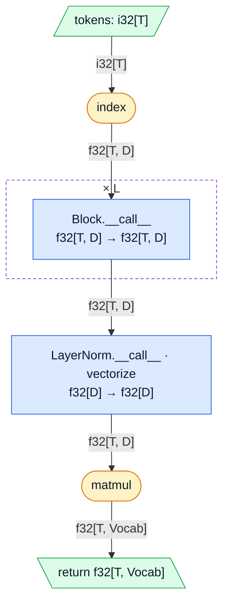

# Cost and diagrams

[← Keys, compiling and sharding](compiling.md) · [Contents](README.md) · [Precision and debugging →](debugging.md)

## Cost estimates

`expex.cost` counts a function's FLOPs, and a module's parameters, as formulas in
its sizes. Like the prover, it needs no data:

```python
print(expex.cost(Stack.__call__))
print(expex.cost(Stack.__call__, B=64, D=1024, blocks=24))
```

```
Stack.__call__   (sizes: B, D, L)
  flops        2·B·D²·L + 10·B·D·L
  parameters   D²·L + D·L
  largest      f32[B,D] (B·D elements)
  note: L = len(self.blocks)
Stack.__call__   (sizes: B=64, D=1024, L=24)
  flops        3236954112   = 3.24 GFLOP
  parameters   25190400   = 25.2 M
```

Dominant terms come first. For the transformer in `examples/`, the four
`D × D` projections give `8·T·D²·L`, the MLP `4·T·D·F·L`, attention
`4·T²·D·L` and the unembedding `2·T·D·Vocab`. Matrix products and loops are
exact (a `for` over `T` multiplies its body by `T`); elementwise operations
count one flop per element, reshapes and gathers are free, and a `while`
loop counts one iteration and says so.

### Profiles, line by line

`expex.debug.profile` puts `expex.cost`'s numbers on the source. It traces the function with
symbolic sizes, so you don't need data. Each line, and each line of the functions it
calls, shows the shape it produces, its FLOPs as a formula and, once sizes are given,
as a number and a share of the total:

```python
report = expex.debug.profile(Stack.__call__, B=64, D=1024, blocks=24)
report.save("profile.html")           # the source as a heat map, FLOPs or bytes
```

For the transformer in `examples/` (`T=1024, D=512, F=2048, Vocab=32000, blocks=12`):

```
Transformer.__call__   (sizes: T=1024, D=512, F=2048, Vocab=32000, L=12)
  flops  8·T·D²·L + 4·T·D·F·L + 4·T²·D·L + 31·T²·L + 20·T·D·L + 8·T·F·L + 2·T·D·Vocab + 16·T·L + 9·T·D + 9·T + 5·L + 2  = 137 GFLOP
  bytes  136·T²·L + …  = 3.77 GB

── Transformer.__call__   transformer.py:86   self 24.4%
   86 | def __call__[T](self, tokens: Int[T]) -> f32[T, Vocab]:
   87 |     x = self.embed[tokens]                                f32[T,D]       3·T                           3.07 kFLOP   0.0%             2.11 MB
   88 |     for block in self.blocks:  # identical blocks: one …
   89 |         x = block(x)                                      f32[T,D]       ×L -                                       0.0%             calls 75.6%  277 MB
   90 |     return self.norm.vectorize(x) @ self.unembed               f32[T,Vocab]   2·T·D·Vocab                   33.6 GFLOP  24.4% ██          131 MB

── MLP.__call__   transformer.py:63   self 37.7%
   64 |     return jax.nn.gelu(x @ self.w1) @ self.w2             f32[T,D]       ×L 4·T·D·F·L + 8·T·F·L        51.7 GFLOP  37.7% ████        931 MB

── Attention.causal   transformer.py:44   self 19.0%
   47 |     scores = q @ k.T / jnp.sqrt(q.shape[-1])              f32[4,T,T]     ×L 2·T²·D·L + 4·T²·L + L      12.9 GFLOP   9.4% █           428 MB
   49 |     weights = jax.nn.softmax(jnp.where(mask, scores, -j…  f32[4,T,T]     ×L 24·T²·L + 4·T·L             302 MFLOP   0.2%             1.11 GB
   50 |     return weights @ v                                    f32[4,T,D//4]  ×L 2·T²·D·L                   12.9 GFLOP   9.4% █           25.2 MB
...
```

- Each operation is counted once, on the innermost line that created it. A line that
  calls into other functions shows their share as `calls`. The per-line counts add up
  to `expex.cost(f).flops`.
- Lines inside a staged loop are multiplied by the loop's trip count and marked: `×L`
  for a loop over a list of modules, `×T` for `range(T)`.
- The last column is the bytes the line's operations produce (data written, not peak
  memory; for peak memory, use `expex.debug.memory`).
- `profile.save("profile.html")`, or a notebook's rich display, gives a self-contained
  page. Each line has a heat map you can switch between FLOPs and bytes, and hovering
  over a line shows its formula. Each function is a collapsible section.

## Diagrams

`expex.diagram` draws a function or a module from a trace with symbolic sizes,
so like `expex.cost` and `expex.prove` it needs no data:

```python
d = expex.diagram(Stack.__call__)                  # depth=1: the calls it makes
print(d)                                        # Mermaid text, for Markdown
d.save("stack.html")                            # an interactive page
expex.diagram(Stack.__call__, depth=2)             # every call opened one level
expex.diagram(Stack.__call__, B=64, blocks=24)     # sizes and list lengths, as for expex.cost
```

For the transformer in `examples/`, `print(expex.diagram(Transformer.__call__))`
gives this, which GitHub draws in a `mermaid` block:



- Each call to an `@fn` is a node showing its input and output types (per
  element for `.vectorize`). `depth=2`, or a click on the page, opens it to show
  the calls inside. A loop over identical layers is one box, `× L`; the
  selective scan in `examples/mamba/` is a box `× T`. A traced `if` or
  `while` is a box too.
- Between calls, only operations that say what the model does are drawn
  (`matmul`, `index`, `sum`, `conv`, ...). Reshapes and elementwise
  arithmetic are skipped, with edges drawn straight across them. Each edge
  follows the data and shows its type.
- The page pans and zooms, opens and folds calls, and shows each call's
  signature, file and line, and source. It loads Mermaid from a CDN.


<!-- To insert at the end of README's "## Diagrams" section, after its bullet list. -->

### Where the time goes, and where shapes fail

`expex.diagram.timed` draws the same diagram from a run on real arguments. It
compiles the function with `jax.jit`, runs it under `jax.profiler`, and colours
each call and loop by its share of the measured time. Shape errors get a
diagram too. A `ShapeError` raised inside a typed call carries `e.diagram`,
which is the trace up to the call that failed:

```python
d = expex.diagram.timed(model.__call__, jnp.ones((256, 16)))  # runs it, under jax.jit and jax.profiler
print(d.text)
d.save("stack_timed.html")                       # each box coloured by its share of the time

@expex.struct
class Probe[D]:
    stack: Stack[D]
    w: f32[D] = 1.0

    def __call__[B](self, x: f32[B, D]) -> f32[B]:
        return self.stack(x[:, 1:]) @ self.w     # a bug: x loses a feature

probe = Probe.init(jr.key(1), D=16, blocks=2)
try:
    probe(jnp.ones((4, 16)))
except expex.ShapeError as e:
    print(e.diagram.text)                        # the trace up to the call that failed
    e.diagram.save("error.html")                 # that call in red, the path into it in red
```

```
Stack.__call__   measured with jax.profiler (CPU): 285 µs of XLA op time per call (summed over threads), 320 µs wall, median of 5 runs
  × 24                  273 µs   95.8%  ███████████████████
    Block.__call__      250 µs   87.8%  ██████████████████
  (outside the calls)   11.9 µs    4.2%
Probe.__call__   ShapeError: traced up to the failing call
  Stack.__call__  ✗ received f32[4, 15], declared x: f32[B, D]

  path:  x: f32[4, 16] → ✗ Stack.__call__

  Stack.__call__(): argument `x` does not match its annotation.
  ...
```

- The profiler names XLA instructions, not Python calls. expex looks each one
  up in the compiled program, where it carries the scopes of the calls it came
  from. A fused instruction that spans calls is split between them. A loop's
  body runs once per iteration, so `× 24` adds up all 24. Each call's time
  includes the calls inside it. Shares are of XLA op time summed over threads,
  so on CPU they can add up to more than the wall time.
- When the profiler can't run, the shares are estimated from FLOPs per box
  (counted as `expex.cost` counts them). The diagram is then labelled `ESTIMATED`.
- `d.timings` maps boxes to (seconds per call, share), and `d.at(2)` opens the
  diagram one level further.
- `e.diagram` is built only when you use it, so calls that succeed cost
  nothing extra. It traces the function again on the arguments' shapes, with
  loops unrolled, up to the call that fails. That call is drawn in red, with
  the type it received and the one it declared, and the edges from the inputs
  to it are red too. The calls around it are open. The error's message is
  unchanged. A note under it says `(see e.diagram.save("error.html"))`.
  `expex.diagram.explain(f, *args)` draws the same thing without running `f`.

---

[← Keys, compiling and sharding](compiling.md) · [Contents](README.md) · [Precision and debugging →](debugging.md)
