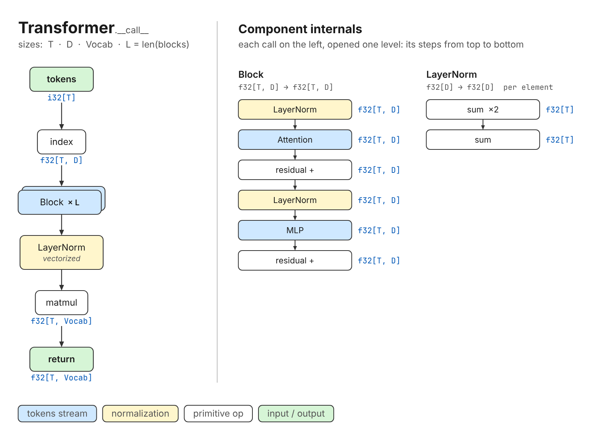

# The design of expex

[← Equinox, Flax, Optax and Orbax](interop.md) · [Contents](README.md)

Research code in JAX carries a second program that nobody runs: the comments
that say what shape each array has. `# q: [B, T, D]` above a function is the
most useful line in it, and the only one the computer ignores.

expex starts from one bet, in the words of its author: *"we want to be
explicit about arrays shapes and collections of arrays shapes. if we are, we
get superpowers from metaprogramming."* The goal is *"clean, pythonic code
that reads clearly for performant research code that is easy to write and
maintain."*
This page explains the bet, how the library is built on it, what it measured
on seven ported projects, what it got wrong, and where it stands among
similar tools.

Every `python` block on this page runs as part of the test suite, and the
output under it is what it printed. Blocks marked `py` are excerpts from the
ports or from the projects they were ported from, and are not run here.

## 1. The idea: the signature is the single source of truth

Here is a residual MLP block, written once:

```python
import re
import annotationlib
import jax, jax.numpy as jnp, jax.random as jr
import expex
from expex import f32

@expex.struct
class MLP[D, F]:
    up: f32[D, F] = jax.nn.initializers.lecun_normal()
    bias: f32[F] = 0.0
    down: f32[F, D] = jax.nn.initializers.lecun_normal()

    def __call__(self, x: f32[D]) -> f32[D]:
        return x + jax.nn.gelu(x @ self.up + self.bias) @ self.down

mlp = MLP(jr.key(0), D=8, F=32)          # every array built from its annotation
print(mlp(jnp.ones(8)).shape)            # written for one vector
print(mlp(jnp.ones((4, 16, 8))).shape)   # called on a batch of sequences
```

```
(8,)
(4, 16, 8)
```

The class says what the block computes, and which sizes each array has. The
library reads those annotations and gets the following from them, with no
other description of the model.

**Checks**, with the size's origin:

```python
try:
    mlp(jnp.ones(5))
except expex.ShapeError as e:
    print("\n".join(str(e).splitlines()[:6]))
```

```
MLP.__call__(): argument `x` does not match its annotation.

    declared  x: f32[D]
    received     f32[5]

    D is 8 (from `self.up: f32[8, 32]`), but axis 0 of `x` is 5.
```

**A proof for every size**, a **cost formula**, and a **summary**, none of
which needs data:

```python
print(expex.prove(MLP.__call__).ok)
print(expex.cost(MLP.__call__))
print(expex.summary(mlp))
```

```
True
MLP.__call__   (sizes: D, F)
  flops        4·D·F + 9·F + D
  parameters   2·D·F + F
  largest      f32[F] (F elements)
MLP   (D=8, F=32)
module  class        params  formula      bytes   flops  flops formula
──────────────────────────────────────────────────────────────────────
up      f32[D, F]       256  D·F        1.02 kB
bias    f32[F]           32  F            128 B
down    f32[F, D]       256  D·F        1.02 kB
──────────────────────────────────────────────────────────────────────
total   MLP             544  2·D·F + F  2.18 kB  1.32 k  4·D·F + 9·F + D
```

**Shardings** from axis names, an **optimizer mask** from the annotations, and
**checkpoints** checked against them:

```python
mesh = jax.make_mesh((jax.device_count(), 1), ("data", "model"),
                     axis_types=(jax.sharding.AxisType.Auto,) * 2)
specs = expex.shardings(mlp, mesh, F="model")       # split the hidden width
print(specs.up.spec, specs.bias.spec, specs.down.spec)
print(expex.mask(mlp, lambda path, spec: spec.ndim == 2))   # weight decay on matrices

expex.save(mlp, "mlp.npz")
try:
    expex.load(MLP, "mlp.npz", F=64)                 # the file has F = 32
except expex.ShapeError as e:
    print(str(e).splitlines()[4].strip())
```

```
P(None, 'model') P('model',) P('model',)
MLP(up=True, bias=False, down=True)
F is 64 (from F=64 passed to expex.load), but axis 1 of `up` is 32.
```

**Migration** works the other way: `expex.annotate` runs plain JAX code on
examples and proposes the annotations, grouping sizes by how data flows
between them rather than by coincidence of value:

```python
def ffn(params, x):
    h = jax.nn.gelu(x @ params["up"] + params["bias"])
    return x + h @ params["down"]

example = {"up": jnp.ones((8, 32)), "bias": jnp.ones(32), "down": jnp.ones((32, 8))}
print(expex.annotate(ffn, example, jnp.ones((4, 8))).signature)
```

```
def ffn[B, D, A](params: Params[D, A], x: f32[B, D]) -> f32[B, D]:
```

The same signatures also drive the architecture diagrams
(`expex.diagram(Transformer.__call__)`, drawn from the code of
[`examples/transformer.py`](../examples/transformer.py)), the line-by-line
profiles, the NaN finder and the editor hints described in the rest of the
guide:

<picture>
  <source media="(prefers-color-scheme: dark)" srcset="images/transformer_dark.png">
  
</picture>

The point is not any one of these tools. Each exists elsewhere in some form.
The point is that none of them needs its own description of the model. In a
typical JAX codebase, the shapes are stated in a docstring, again in an `assert`,
again in the `in_axes` of a `vmap`, again in a `PartitionSpec`, again in an
optimizer's mask function, and again in the checkpoint loader. These copies
drift apart. In expex they are one annotation, and the tools read it.

## 2. How it works

expex is a thin layer over JAX. It does not wrap arrays or replace `jax.jit`,
`jax.grad` or `jax.vmap`: an `@expex.fn` is a Python callable that JAX
transforms like any other. Six mechanisms do the work.

### Annotations are read as text (Python 3.14)

`f32[T + 1]` is not a valid annotation in older Pythons: `T` is a type
parameter, and adding 1 to it raises. Python 3.14 evaluates annotations
lazily (PEP 649), and its `annotationlib` module can return them as the text
that was written. expex reads that text and evaluates it again, with each
size replaced by a symbol that records arithmetic:

```python
def grow[T](x: f32[T]) -> f32[T + 1]:
    return jnp.pad(x, (0, 1))

try:
    grow.__annotations__
except TypeError as e:
    print("TypeError:", e)
print(annotationlib.get_annotations(grow, format=annotationlib.Format.STRING))
print(expex.fn(grow)(jnp.ones(3)).shape)
```

```
TypeError: unsupported operand type(s) for +: 'typing.TypeVar' and 'int'
{'x': 'f32[T]', 'return': 'f32[T + 1]'}
(4,)
```

Each signature is parsed into specs once. Sizes can be computed
(`f32[heads, D // heads]`), constrained by a leading `assert D % heads == 0`,
fixed by a type parameter's default (`def f[B, Rows = 6]`), or variadic
(`f32[*Batch, D]`). Annotations can be nested in containers, NamedTuples,
dataclasses and structs, so *collections* of arrays have shapes too:
`params: Params[D, A]` binds `D` from whichever field shows it first.

### Sizes are type parameters, and the body uses them by name

PEP 695 syntax (`def f[B, T, D](...)`, `class MLP[D, F]`) declares the sizes
where a reader looks for them. expex rewrites the body so that these names
mean something there too: as a value, `D` is its size in this call
(`jnp.zeros(D)`, `range(T)`, `xz[:, :E]`); as an axis argument, it is that
axis (`x.mean(T)`, `axis=T`). Contractions and reshapes name only their
result: `expex.einsum(q, k, to=(B, T, S))`, `expex.rearrange(x, to=(H, T, K))`.
The sizes are bound when the arguments are checked, so under the prover the
same names are symbols, and code built from them is proved for all sizes.

### Plain control flow, converted from source

JAX asks for `lax.scan`, `lax.cond` and `lax.while_loop` wherever control flow
depends on traced values. expex reads the function's source, rewrites each
`if`, `while` and `for` into a call to a small runtime, and compiles the result
in the original's globals and closure. At run time, the runtime looks at what
it got: on Python values each statement runs exactly as written; on traced
values `if` becomes `lax.cond`, `while` becomes `lax.while_loop`, and `for`
becomes `vmap` when its iterations are independent or `lax.scan` when they
carry state. `x[i] = v` becomes `x.at[i].set(v)`, and `break`, `continue` and
`return` inside loops are lowered to flags. `f.flow` says what happened:

```python
@expex.fn
def smooth[T, D](xs: f32[T, D], decay: f32) -> f32[T, D]:
    h, out = jnp.zeros(D), []
    for t in range(T):
        if decay > 0:
            h = decay * h + (1 - decay) * xs[t]
        else:
            h = xs[t]
        out.append(h)
    return jnp.asarray(out)

jax.jit(smooth)(jnp.ones((5, 3)), 0.9)
print(list(smooth.flow.values()))
print(expex.prove(smooth).ok)
```

```
['for -> lax.scan (carries h)', 'if -> lax.cond']
True
```

The conversion stops where Python semantics cannot be kept on traced values,
and says so rather than guessing. A list that grows inside a traced `if` would
have a data-dependent length; a non-array value changing inside a traced loop
cannot be carried by `lax.while_loop`; a dict updated in a traced branch would
be updated once, at trace time. Each is a `StageError` with a code
([EX204–EX211](errors.md#ex204)) and a fix:

```python
@expex.fn(jit=True)
def positives(x: f32) -> f32:
    ys = []
    if x > 0:
        ys.append(x)
    return jnp.asarray(ys).sum()

try:
    positives(1.0)
except expex.StageError as e:
    print(e.code, str(e).splitlines()[0].split(", ")[-1])
```

```
EX205 so the list's length would depend on data.
```

Code inside `try` / `with`, loops with an `else`, in-place updates of
anything but a local variable, and variables shared with a nested function are
left as plain Python ([Reference: Limitations](reference.md#limitations)).

### Proofs from JAX's shape polymorphism

`jax.export` can trace a function with *symbolic* sizes, for exporting a
program that works for any batch size. Its symbolic dimensions support
arithmetic and comparisons, so the shapes they produce are expressions:

```python
from jax import export

T, D = export.symbolic_shape("T, D")
spec = jax.ShapeDtypeStruct((T, D), jnp.float32)
print(jax.eval_shape(lambda x: x[1:] - x[:-1], spec).shape)
```

```
(T - 1, D)
```

`expex.prove` builds abstract inputs from the annotations, one symbolic
dimension per size, with the leading `assert`s as constraints, and traces
the function with `jax.eval_shape`. If the traced result has the declared
shape, the annotation holds for every size, without data and without
compiling. Parameters such as `heads: int` are tried at a few values; a struct
argument is invented from its class; a callable argument is replaced by a
stand-in that returns its declared result. When a shape operation is
inconclusive on symbols, the prover falls back to a few concrete sizes and
reports `spot-checked`, not `proved`. `expex.cost`, the summaries, the
profiles and the diagrams run on the same symbolic trace, which is why their
outputs are formulas.

### Batching from annotated core ranks

An annotation says how many axes are the function's own. A call whose
arguments have more leading axes than that is mapped over the extra ones,
like `jnp.vectorize` with its core dimensions read from the signature. This
is the feature that removes the most code in the ports: norms, MLPs, losses,
game rules and ray renderers are written for one element and called on
batches, with no `vmap` and no `in_axes`. A call is mapped only when extra
leading axes are all that keep it from matching, so a correctly shaped call
runs exactly as before; `vectorize=False` turns it off.

Nested mapping has a cost that the ports exposed (section 3): `vmap` of a
per-point layer inside a per-ray function gives XLA a dot with two free axes,
and a weight gradient that contracts over two axes. While it traces a mapped
call, expex merges the mapped axis into the free axis next to it, which is
what a hand-written `reshape(rays * samples, features)` does. It does this by
replacing JAX's batching rule for `dot_general`, a rule that is active only
inside expex's own mapped calls:

```python
rays = jnp.ones((1024, 64, 3))                    # 1,024 rays of 64 points

def dots(f, *args):                               # the shapes of the dots in f's program
    jax.clear_caches()                            # (JAX reuses batched forms of jnp.matmul)
    return re.findall(r"(f32\[[\d,]+\]) = dot_general", str(jax.make_jaxpr(f)(*args)))

def ray_vmap(w, points):                          # nested jax.vmap
    return jax.vmap(lambda p: jax.nn.relu(p @ w))(points).sum(0)

print(dots(jax.grad(lambda w: jax.vmap(ray_vmap, (None, 0))(w, rays).sum()), jnp.ones((3, 8))))

@expex.struct
class Point[D, F]:
    w: f32[D, F]

    def __call__(self, p: f32[D]) -> f32[F]:
        return jax.nn.relu(p @ self.w)

@expex.fn
def ray[S, D, F](layer: Point[D, F], points: f32[S, D]) -> f32[F]:
    return layer(points).sum(S)                   # a per-point layer on S points

print(dots(jax.grad(lambda l: ray(l, rays).sum()), Point(jnp.ones((3, 8)))))
```

```
['f32[1024,64,8]', 'f32[8,3]']
['f32[65536,8]', 'f32[8,3]']
```

The values are the same; the second program's forward dot has one free axis,
and its weight gradient contracts over one axis of 65,536 rather than two.

### What runs per call, and what only at trace time

Everything above happens in Python, before XLA sees the program. Under
`jax.jit`, the checks, the size bindings and the control-flow decisions run
once, while tracing, and leave nothing in the compiled program. The jaxpr of a
typed function is the jaxpr of the same plain function:

```python
@expex.fn
def mix[B, T, D](x: f32[B, T, D], w: f32[D, D]) -> f32[B, T, D]:
    return jnp.tanh(x @ w)

def mix_jax(x, w):
    return jnp.tanh(x @ w)

args = jnp.ones((2, 3, 4)), jnp.ones((4, 4))
print(str(jax.make_jaxpr(mix)(*args)) == str(jax.make_jaxpr(mix_jax)(*args)))
```

```
True
```

What remains per call is Python dispatch. `benchmarks/` measures it against
the same thing written in plain JAX. In the most recent committed run
([`results/cpu-2026-11-23-quick.md`](../benchmarks/results/cpu-2026-11-23-quick.md),
load average 10.5 on 4 cores):

| Case | Plain JAX | expex | Difference |
|---|---|---|---|
| jitted call (`x @ w`, 4 × 8) | 5.4 µs | 5.4 µs | none measured |
| jitted method on a struct | 6.3 µs | 6.3 µs | none measured |
| `donate="auto"` step, against `donate_argnums=0` | 4.2 µs | 5.5 µs | +1.3 µs |
| eager typed call (checks, no compilation) | — | 5.0 µs | +5.0 µs |

The default run in [`results/cpu-2026-11-23.md`](../benchmarks/results/cpu-2026-11-23.md),
taken under heavier load (9 to 17 on 4 cores), measured +3.0 µs for the jitted
call, +6.6 µs for the method and +17.6 µs for the eager check, with
interquartile spreads of 10–61%: at this scale the machine's noise is as
large as the difference. An eager *mapped* call is compiled from its second
call on, so it ran in 31.5 µs where an uncompiled `jax.vmap` took 313 µs; that
compares compiled with uncompiled code, and says only that eager batching is
not a trap.

## 3. Evidence: seven ports

To test the idea on code that people use, seven JAX projects were rewritten in
this style and checked against the originals, with the original's parameters
loaded into the port ([Reference: Ported projects](reference.md#ported-projects)).

| Project | Lines of code, port vs original | Matches the original | Functions proved |
|---|---|---|---|
| PureJaxRL PPO | not counted | first 64 of 976 updates identical, then float32 drift | all |
| mamba-jax | not counted | logits to 6e-7, sampled tokens exact | 12 |
| llama-2-jax | 101 in 1 file vs 478 in 15 | logits to 8e-7, greedy tokens exact | 11 |
| Pgx Connect Four, Othello | 81 vs 161; 107 vs 204 | every field of every state, 1,024 games | 15 |
| Vision Transformer | 85 vs 183 (157 without the ResNet stem) | logits to 5e-7, gradients to 9e-7 | 8 |
| mctx MuZero, Gumbel MuZero | 340 in 1 file vs 691 in 7 | every array of every tree bit-identical | 26 |
| JaxNeRF | 138 vs 334 | pixels to 2.4e-7, training loss exact | 12 |

Lines count code only, no blanks, comments or docstrings, and the originals
often do more (ViT has more classifier options; the port writes out the
attention, dense and norm layers that the original takes from Flax). The
counts come from [docs/reference.md](reference.md#ported-projects); the PPO
and Mamba ports were not counted the same way.

**Readability** is the harder claim to measure. The clearest case is mctx's
tree search, which the original writes for a batch of trees with
`lax.while_loop`, `lax.cond` and `vmap`. Its backward pass:

```py
# mctx (excerpt)
def body_fun(loop_state):
    tree, leaf_value, index = loop_state
    parent = tree.parents[index]
    count = tree.node_visits[parent]
    action = tree.action_from_parent[index]
    reward = tree.children_rewards[parent, action]
    leaf_value = reward + tree.children_discounts[parent, action] * leaf_value
    parent_value = (tree.node_values[parent] * count + leaf_value) / (count + 1.0)
    children_values = tree.node_values[index]
    children_counts = tree.children_visits[parent, action] + 1
    tree = tree.replace(
        node_values=update(tree.node_values, parent_value, parent),
        node_visits=update(tree.node_visits, count + 1, parent),
        children_values=update(tree.children_values, children_values, parent, action),
        children_visits=update(tree.children_visits, children_counts, parent, action))
    return tree, leaf_value, parent

tree, _, _ = jax.lax.while_loop(cond_fun, body_fun, loop_state)
```

The port (`examples/mctx/search.py`), written for one tree, `Tree[N, A, E]`:

```py
while node != ROOT:
    parent, action = self.parents[node], self.action_from_parent[node]
    value = self.children_rewards[parent, action] + self.children_discounts[parent, action] * value
    child_values[parent, action] = values[node]
    child_visits[parent, action] += 1
    values[parent] = (values[parent] * visits[parent] + value) / (visits[parent] + 1.0)
    visits[parent] += 1
    node = parent
```

Both compile to a `lax.while_loop`, and the trees they build are
bit-identical.

**Speed.** `benchmarks/` runs each original and its port on the same inputs,
jit-compiled, in interleaved rounds, and reports the best round, the median,
and an interquartile range that pairs the original's quartiles with the
port's opposite ones. All numbers are on a shared 4-core CPU VM while other
jobs ran, with a load average of 9 to 17; no GPU results exist yet. Above 1x
the port is faster:

| Measure | Best (median; IQR range) | File |
|---|---|---|
| PPO, full training run | 1.41x (1.05x; 0.87–1.39) | `cpu-2026-11-23.md` |
| Mamba forward, T = 2,048 | 14.1x (9.7x; 6.8–14.2) | `cpu-2026-11-23.md` |
| Mamba gradient | 5.97x (5.17x; 4.57–6.14) | `cpu-2026-11-23.md` |
| Llama forward / gradient | 0.97x (1.30x; 0.52–1.96) / 1.04x (1.13x; 0.80–1.29) | `cpu-2026-11-23.md` |
| Connect Four, 1,024 games | 1.65x (1.40x; 0.95–2.17) | `cpu-2026-11-23.md` |
| mctx MuZero / Gumbel | 1.04x (0.72x; 0.40–1.77) / 0.83x (1.28x; 0.75–1.50) | `cpu-2026-11-23-vit-mctx-nerf.md` |
| NeRF render | 0.76x (0.99x; 0.87–1.17) | `cpu-2026-11-23-vit-mctx-nerf.md` |

Most ranges straddle 1: on this machine the ports and the originals run at
the same speed within the noise. Connect Four is probably faster (its range
dips just below 1). Only Mamba is clearly different, and that is not the
library's doing: the original materialises the full `T × E × N` decay tensor
before scanning and recomputes it under `jax.checkpoint`, while the port's
plain `for` loop over time computes one step's decay at a time. Writing the
loop plainly made the cheap version the obvious one, but the same loop can be
written in plain JAX with `lax.scan`.

**The gaps, and how they were fixed.** The same committed runs also showed
four gaps whose ranges stay below 1, or nearly: ViT gradients at 0.78x
(0.73x median; 0.58–0.94), NeRF gradients at 0.62x (0.93x median;
0.73–1.06), Mamba generation at 0.47x (0.64x median; 0.38–0.92), and Othello
at 0.71x (0.75x median; 0.57–1.08). Reading the compiled HLO explained three
of them:

- *Dot batching.* ViT and NeRF write layers for one token or one point and
  call them on batches, so their matmuls were nested `vmap`s. XLA:CPU got dots
  with several free axes, and transposes and copies around them. expex now
  merges those batch axes while mapping (the `dot_general` shapes in
  section 2), which is what the originals' reshapes do by hand.
- *Layer unrolling.* A loop over identical layers is one `lax.scan`, so a
  deep model traces in the time one layer takes. But a scanned stack stacks
  its activations and does not fuse across layers. Stacks of up to 16 layers
  are now given to XLA unrolled (`expex.config(unroll_layers=...)`). This
  closed Mamba's generation gap, whose original unrolls its layers.

After these changes, [docs/reference.md](reference.md#ported-projects)
reports ViT gradients at 0.92x best and 0.99x median, NeRF gradients at 1.02x
best and 0.95x median, and Mamba generation at 1.05x. These later runs are
not yet in `benchmarks/results/`, which still holds the runs before the fixes.

**Othello, a lesson about XLA:CPU.** The fourth gap was in the port's code,
not the library. Pgx's Othello shifts the board with precomputed mask tables.
The port instead computed each direction's edge mask from the row and column
of each square, in the shift itself, which reads better and needs no table.
It was correct, but XLA:CPU recomputed those masks for every game in the
batch, which made the run about 10% slower. With the masks computed once,
outside the shifts, Othello runs at Pgx's speed (0.96x best, 1.02x median,
0.81–1.19, in a 30-round rerun that is not in `benchmarks/results/`), with
every state still identical. A related fact decided the board's layout:
XLA:CPU runs the shifts of a `[games, 64]` board about three times faster
than those of a `[games, 8, 8]` one, so the port keeps it flat, as Pgx does.
Neither fact is about expex, and both are the kind of thing a port only finds
by profiling.

## 4. What the checks found

**In dynamax.** dynamax, a library of state-space models, is annotated
throughout with jaxtyping. jaxtyping checks annotations only under
`@jaxtyped` or its import hook, and dynamax's tests run without either. Since
expex reads jaxtyping annotations directly ([Porting](porting.md#coming-from-jaxtyping)),
the experiment was to wrap all 167 annotated functions and methods in
`@expex.fn` and run dynamax's own tests (at commit `ffc626b`), with automatic
batching off. Without expex, 104 tests pass and one fails on a float
tolerance. With it, 54 fail and one test module fails to collect, all but one
of them on `ShapeError`s from the annotations of nine functions. They are
mistakes in the annotations: the code is right, and the annotations, read as
documentation, are wrong:

- `dynamics_input_weights` is `"state_dim input_dim"` in one file and
  `"input_dim state_dim"` in another; the arrays are the former.
- `_predict(probs: Float[Array, " num states"])`: a space where an
  underscore was meant, so the annotation declares two axes, `num` and
  `states`, for a vector.
- Parameters annotated `"state_dim state_dim"` are passed with a leading time
  axis, which the code supports and the annotation does not say.
- `None` and scalars passed where `inputs: Float[Array, "input_dim"]` is
  declared.

This was recorded in the commit that added jaxtyping support (`0fe5818`). The
run's logs are not in the repository.

**In expex itself.** The ports were also the library's hardest tests, and
each one found bugs, now regression tests in `tests/regressions/`. Pgx found
that `0 <= r < 8` was not converted when nothing else in the function was, so
under `jit` Python asked for a tracer's truth value. Llama found that a
method whose annotations named its own class lost all of them, silently, so
nothing in it was checked or proved. ViT found that the prover used
`H % P == 0` only when `P` was a number, so a patch grid was spot-checked
rather than proved, and mctx that a callable argument with a declared result
was skipped by the prover instead of proved for any such function. A traced
`if` traced each branch more than once. Another silent failure:
`f32[T ** 2]` and `f32[T / 2]` evaluated to nothing usable, so the annotation
was dropped and a wrong shape passed. They are now an error when the function is defined
([EX403](errors.md#ex403)).

## 5. Limits and trade-offs

- **Python 3.14 only.** Size arithmetic in annotations depends on lazy
  annotations and `annotationlib`, so expex does not run on older versions.
- **Conversion needs source.** Functions defined with `exec` or at a bare
  interactive prompt run unconverted, and `f.info()` says why. Wrapping
  another decorator (jaxtyping's `@jaxtyped`) also leaves the body
  unconverted.
- **Some constructs are refused.** Lists that grow under a traced condition,
  non-array values changing in a traced loop, `range` with a traced step,
  in-place updates of Python objects in traced code. A variable assigned on
  only one traced path reads as zeros on the other. The errors are specific,
  but they are constraints on how you write.
- **Type checkers do not understand it all.** Under mypy, `f32[T + 1]` needs
  `# type: ignore[valid-type]` and a leading `assert T >= 2` needs
  `# type: ignore[misc]`; a fixed size written `def f[Rows = 6]` needs a
  `# type: ignore[misc]` on the `def` line under both mypy and pyright. Where
  code must type-check unchanged, `def f[Rows = Literal[6]]`, the bound
  `Rows: Literal[6]` and `class Rows(Dim, size=6)` work.
- **Automatic batching can hide mismatches.** In code whose annotations were
  never enforced, an array with an extra axis is mapped over instead of
  rejected. In the dynamax run with batching on, the 26 `ShapeError`s from
  `make_lgssm_params` did not occur: the time-varying weights were silently
  mapped over. Run such code with `expex.config.vectorize = False` first.
- **Compile time.** The ports usually compile slower than the originals in the
  committed runs: Llama's forward pass 0.93 s → 1.86 s, Mamba's gradient
  4.44 s → 6.89 s, NeRF's gradient 8.73 s → 12.48 s; PPO compiles faster
  (19.2 s → 10.1 s). Unrolling short layer stacks trades compile time for run
  time again. Scanning long Python loops instead of unrolling them is the
  other side: a 1,000-step loop compiles in 0.06 s rather than 8 s
  ([Functions](functions.md#plain-python-on-traced-values)). Compile time is
  being worked on.
- **Stateful Flax NNX modules.** Automatic mapping and loops over identical
  layers run the body under `vmap` or `lax.scan`, where NNX refuses to update
  its variables. A method that updates state (dropout drawing from
  `nnx.Rngs`, batch-norm statistics) must be written for the batch, with
  `vectorize=False` ([Interop](interop.md)).
- **It leans on JAX internals.** `debug.find_nan` and parts of the prover
  read jaxpr details, and the merged dots replace one of JAX's batching rules;
  all are tested on JAX 0.12 and may need work on later versions. A
  `spot-checked` verdict is evidence, not proof.

## 6. Related work

**jaxtyping** (and its PyTorch predecessor **torchtyping**) annotate arrays
with dtype and shape as strings: `Float[Array, "batch seq"]`. Checks run at
call time with a runtime type checker under `@jaxtyped`, which also makes
sizes consistent across one call. The annotations are compatible with static
type checkers as plain array types. expex adopts the same idea and reads
jaxtyping's annotations unchanged. It differs in what it does with them: the
sizes are type parameters usable in the body, annotations are proved for all
sizes, and they drive batching, conversion and the tools.

**Runtime shape checkers** came before. tsanley labels local variables with
shape strings (`y: 'b,d' = ...`) and checks them by tracing execution with
`sys.settrace`; it can also annotate code from a logged run, as
`expex.annotate` does. tensorcheck is a decorator that checks NumPy and
PyTorch arguments against dicts of shape, dtype and value range. **chex**
gives JAX explicit assertions (`chex.assert_shape`, `assert_rank`,
`assert_equal_shape`) and testing utilities. All of these check values at run
time; none proves shapes for all sizes or uses them for anything else.

**Equinox** and **Flax** are module systems. Equinox modules are frozen
dataclasses registered as pytrees, with filtered transformations; Flax linen
separates module definitions from parameter dicts (`init` / `apply`), and NNX
uses mutable Python objects. `@expex.struct` is closest to Equinox's design,
with construction from annotations added. expex also runs inside both: its
methods can be decorated with `@expex.fn` ([Interop](interop.md)).

**Named tensors** put axis names on the values: PyTorch's named tensors (a
prototype feature), xarray's labelled dimensions and coordinates, Haliax's
named axes for JAX, and Dex, a research language whose array types are
indexed by typed index sets. Operations then align and reduce by name. expex
puts the names on the signature instead. Arrays stay plain `jax.Array`s with
positional axes, so every JAX function works on them unchanged and naming
costs nothing at run time. In exchange, names do not travel with arrays
through arbitrary operations: they come from annotations, annotated locals,
and the `to=` of `expex.einsum` and `expex.rearrange`.

**Shape polymorphism in `jax.export`** is the machinery the prover is built
on. JAX uses it to export a program that works for any batch size. expex uses
it to check that a function's declared output shape follows from its declared
input shapes.

**AutoGraph**, the converter behind `tf.function`, rewrites Python `if`,
`while` and `for` on tensors into TensorFlow graph operations by
source-to-source transformation. expex's converter follows the same approach
for JAX's `lax` primitives, and adds the shape annotations: sizes used by
name, loops proved for symbolic lengths, and the choice between `vmap` and
`lax.scan` for a `for` loop.

## 7. Summary

The library rests on one decision: shapes are written once, in the signature,
in a form that can be read as symbols. Everything else follows from reading
them. The ports give evidence that this produces shorter code (in the five
that were counted) that computes the same numbers at about the same speed on CPU, within the noise of a
loaded machine; the gaps they found were fixed in the library or, in
Othello's case, in the port. The dynamax experiment shows the checks find
real annotation errors in code that already had annotations. The costs are
Python 3.14, source-based conversion with its refusals, some friction with
static type checkers, and compile times that are still being worked on.

---

[← Equinox, Flax, Optax and Orbax](interop.md) · [Contents](README.md)
